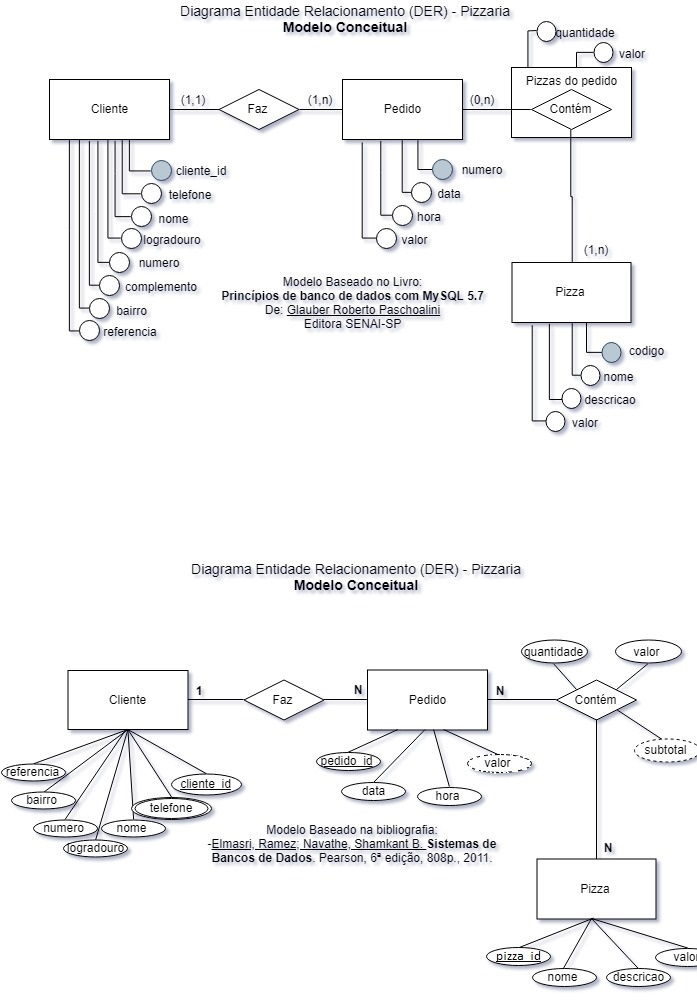

# Pedidos Pizzaria - Sistema SQL
## Descrição
Este repositório contém as atividades práticas desenvolvidas durante a **Aula 09**, focada na utilização das linguagens **DQL (Data Query Language)**, **DML (Data Manipulation Language)** e **DDL (Data Definition Language)** em um banco de dados MySQL/MariaDB para uma Pizzaria.

## Tecnologias utilizadas
* **SGBD:** MySQL / MariaDB (via XAMPP / PhpMyAdmin)
* **Editor de Código:** Visual Studio Code (VS Code)
* **Linguagem:** SQL (DDL, DML, DQL)

## Modelo Conceitual do Banco de Dados

